<div align="center">

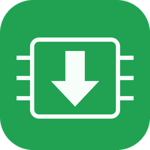

# PartHive

**Type an LCSC number. Get the symbol, footprint and 3D model — in your KiCad library, linked and ready.**


</div>

---

PartHive is a KiCad plugin that imports parts from **EasyEDA / JLCPCB (LCSC)** by
their part number (e.g. `C25804`). It writes the **symbol**, **footprint** and
**3D model** into your own library, links them together, registers the library
in KiCad (globally or just for one project), and even pins project libraries
at the top of *Add Symbol* / *Add Footprint*.

> All screenshots below are of the real plugin (KiCad 10, dark theme) on a demo
> project.

<p align="center">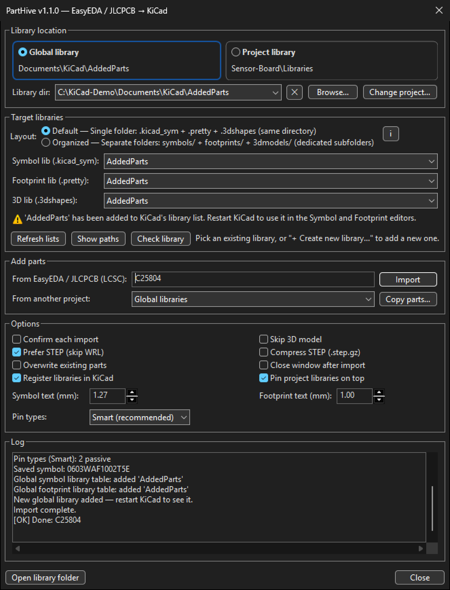</p>

## Contents

- [Features at a glance](#features-at-a-glance)
- [Install](#install)
- [Quick start](#quick-start)
- [Global or project library](#global-or-project-library)
- [Target libraries](#target-libraries)
- [Create, rename and delete libraries](#create-rename-and-delete-libraries)
- [Importing a part](#importing-a-part)
- [Copy parts from another project](#copy-parts-from-another-project)
- [Fix links after pasting a circuit](#fix-links-after-pasting-a-circuit)
- [Live notices](#live-notices)
- [Options](#options)
- [Pin types](#pin-types)
- [Symbol fields](#symbol-fields)
- [Name rules](#name-rules)
- [Where PartHive keeps things](#where-partHive-keeps-things)
- [Building the install zip](#building-the-install-zip)
- [License and credits](#license-and-credits)

## Features at a glance

| | |
|---|---|
| ⚡ **One-number import** | Symbol + footprint + 3D model (STEP or WRL) from EasyEDA / JLCPCB |
| 🔗 **Linked for you** | Symbol → footprint (`Lib:R0603`) and footprint → 3D model |
| 🌍 **Global or 📁 project library** | Registered in KiCad's global list or the project's own, with `${KIPRJMOD}` paths |
| 🧠 **Remembered per project** | Each project reopens on the choice you made for it — even with two KiCads open |
| 📌 **Auto-pin** | Project libraries land at the top of *Add Symbol* / *Add Footprint* |
| ✏️ **Library manager** | Create, rename and delete libraries — KiCad's lists, links and pins follow |
| 📦 **Copy parts between projects** | Symbol + footprint + 3D model from another project's (or a global) library, links re-pointed |
| 🩹 **Fix pasted circuits** | Finds symbols linked to libraries the project doesn't have, copies or re-links them — ERC clean again |
| 🔍 **Similar footprints** | Suggests the nearest footprints you already have (`SOT-23` for `SOT-23-3_L2.9…`, `DFN` for `PDFN`) |
| 🛡️ **Safe names** | Unique names, no Windows-reserved or variable-like names |
| 💡 **Live notices** | Tells you when a library is new, needs a restart, or clashes |
| ⚡ **Smart pin types** | Fixes EasyEDA's undefined / wrong electrical pin types (power in/out, passive, no connect) so ERC can check your supplies |
| 🏷️ **Ordering fields** | `LCSC Part #` and `JLCPCB Link` on every symbol |

## Install

**From the NeoCircuitsLab repository (recommended, gets updates)**

1. In KiCad: **Plugin and Content Manager → Manage…** (repositories) → **+** and add
   `https://neocircuitslab.github.io/kicad/repository.json`.
2. Pick that repository, find **PartHive**, **Install**, **Apply Pending Changes**.
3. Restart KiCad. The **PartHive** button appears in the PCB Editor toolbar
   (*Tools → External Plugins → PartHive*).

**From a file:** download `PartHive-<version>.zip` from the
[Releases](https://github.com/neocircuitslab/PartHive/releases) page, then
**Plugin and Content Manager → Install from File…** and restart KiCad.

**Manual:** copy the contents of `plugins/` to
`Documents\KiCad\<version>\3rdparty\plugins\com_github_neocircuitslab_parthive\`
and refresh plugins. (Clone with `--recurse-submodules`, or the converter folder
`plugins/easyeda2kicad-ph` stays empty.)

No `pip install` needed — the EasyEDA converter is bundled. (In KiCad's *API*
plugin mode, KiCad installs `kicad-python` itself to find the open project.)

## Quick start

1. Open your board and click **PartHive**.
2. Pick **Global library** or **Project library**.
3. Choose a layout (*Default* or *Organized*) — the first time for a folder.
4. Type an LCSC number such as `C25804` and press **Import**.
5. The first time a new library is added: restart KiCad (global) or close and
   reopen the project (project library).

## Global or project library

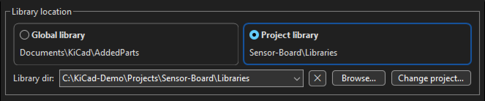

- **Global library** — added to KiCad's global library list, available in every project.
- **Project library** — added to the project's own `sym-lib-table` / `fp-lib-table`
  (next to the `.kicad_pro`), defaulting to `<project>\Libraries`, with
  `${KIPRJMOD}` paths so the project can be zipped, moved or shared.

The choice is **remembered per project**: a project PartHive hasn't seen opens on
Global; once you pick *Project library*, it reopens that way. Two KiCad windows
with two projects each keep their own choice. **Change project…** picks a
`.kicad_pro` by hand.

<p align="center">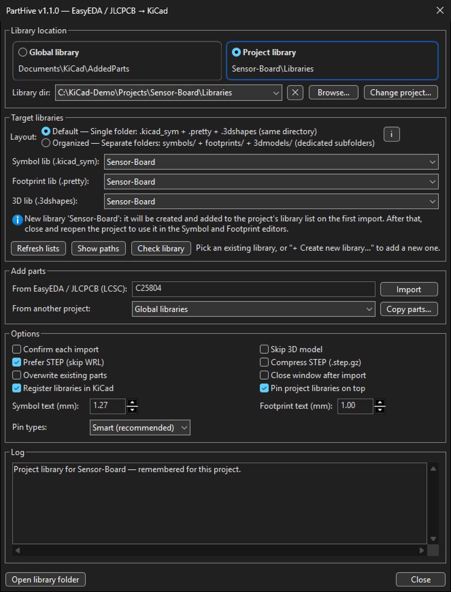</p>

The **Library dir** is pick-only (no half-typed paths): choose a recent folder or
use **Browse…**. The list shows every full path:

<p align="center">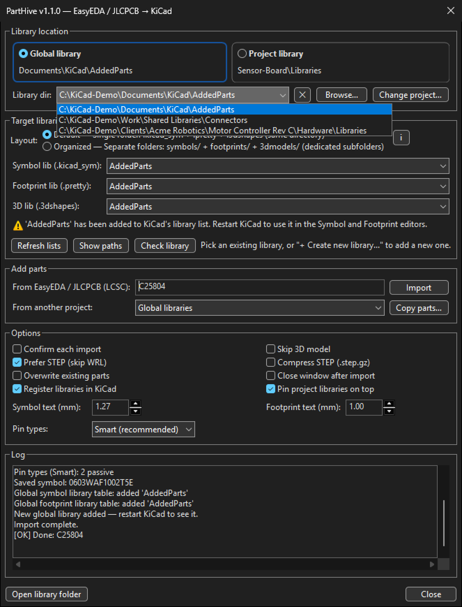</p>

## Target libraries

Symbols, footprints and 3D models can go to **separate, independently named**
libraries. Names follow the folder (`…\Sensor-Board\Libraries` → `Sensor-Board`),
and nothing is written to disk until the first import.

Two layouts — press **i** to see them:

<p align="center">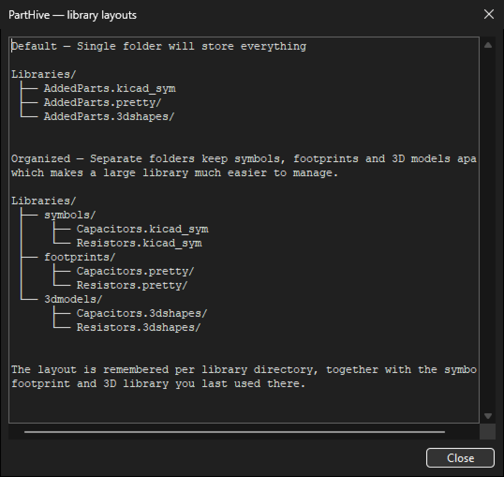</p>

## Create, rename and delete libraries

Each library list starts with **+ Create new library…**, **✏ Rename library…** and
**✕ Delete library…**:

<p align="center">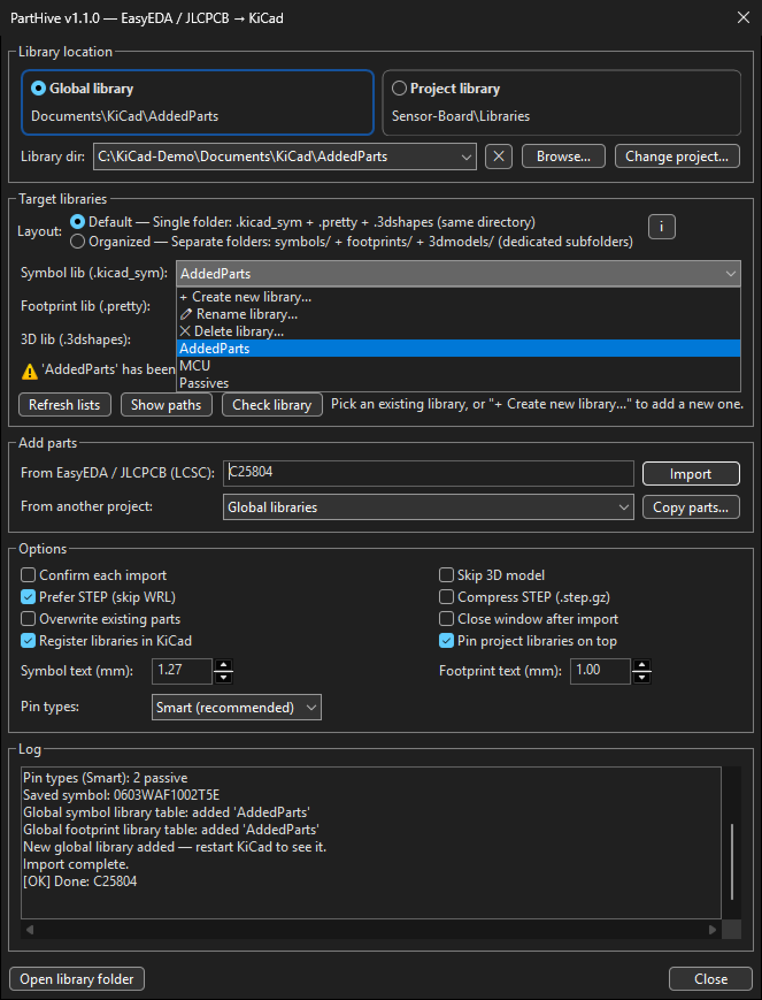</p>

**Create** — one name for symbol, footprint and 3D (ticked by default):

<p align="center">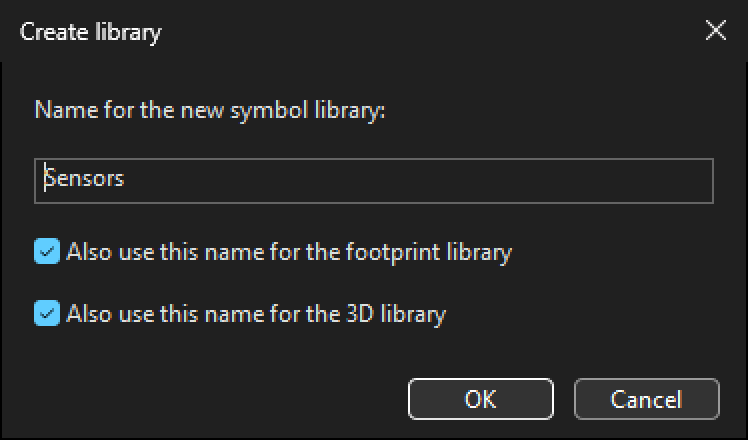</p>

**Rename** — pick the library, type the new name:

<p align="center">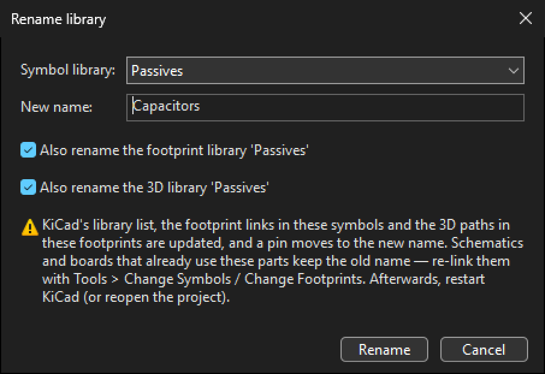</p>

**Delete** — pick the library; its files go to the Recycle Bin:

<p align="center">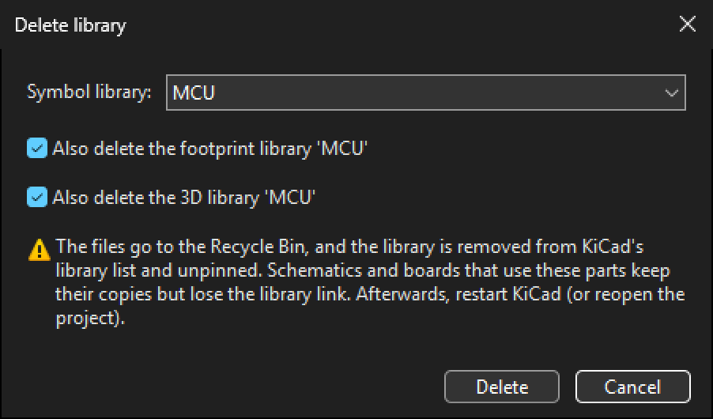</p>

The other two library types get a checkbox each — **ticked** when a library with
the same name exists, **greyed out** when it doesn't.

- **Rename** renames the files, the entry in KiCad's library list, the footprint
  links in the symbols (`Old:R0603` → `New:R0603`), the 3D paths in the footprints,
  and moves the project pin.
- **Delete** sends the files to the **Recycle Bin** (on network / removable drives
  they're moved to `%APPDATA%\PartHive\deleted\` instead), removes the library from
  KiCad's list and unpins it.
- Schematics and boards that already use the parts keep the old library name —
  re-link them with *Tools → Change Symbols / Change Footprints*.

## Importing a part

With **Confirm each import** on, PartHive shows what it will write and lets you
rename, **Skip** (keep the existing file) or **Use existing** for each item:

<p align="center">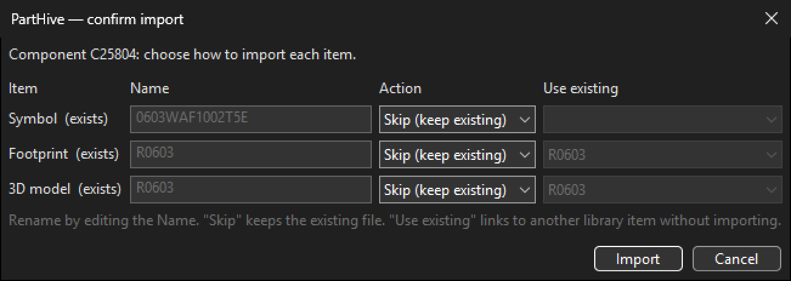</p>

### Similar footprints

EasyEDA names footprints like `SOT-23-3_L2.9-W1.3-P1.90-LS2.4-BR`, while your
library may already have `SOT-23` or `SOT-23-3`. PartHive shows the nearest ones
under the footprint row — click a chip to link that footprint instead of importing
a new one (click it again to go back to Import):

<p align="center">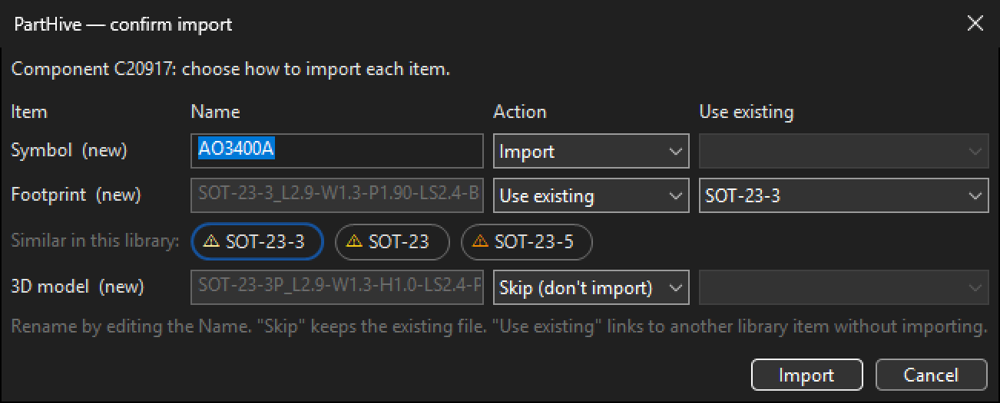</p>

| ⚠ | Meaning | Importing `SOT-23-3_…` (3 pads) |
|---|---|---|
| light yellow | same package and pad count — only the size details differ | `SOT-23-3` |
| yellow | the package name shares the prefix, same pad count — or the same family under another name (`PDFN` / `DFN`, `WSON` / `DFN`, `VQFN` / `QFN`, `SOP` / `SOIC`) | `SOT-23` |
| deep yellow | same family, different pad count — check before linking | `SOT-23-5` |

Matching is strict about the package prefix: `SOT-23` never matches `SOT-223`,
and `R0603` never matches `C0603`. Hover a chip to see why it was suggested.
Nothing is linked unless you click it.

When the footprint is set to **Use existing**, the 3D model switches to **Skip**
(the existing footprint already has its model). You can set it back to Import.

A project-library import — including the automatic pin:

<p align="center">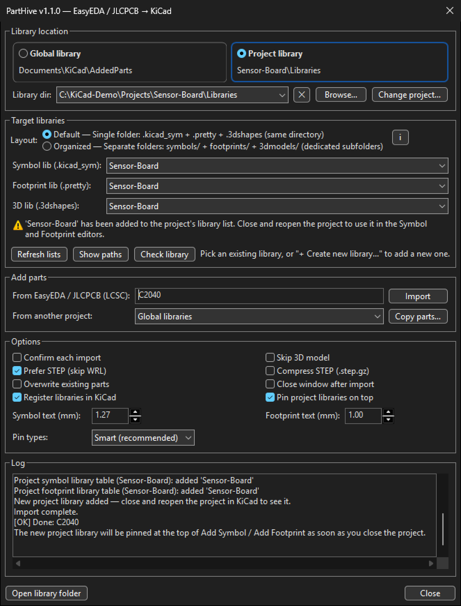</p>

## Copy parts from another project

Common parts don't have to live in one big global library. In **Add parts →
From another project**, pick a project (KiCad's recent projects and every project
PartHive knows, or **Browse…**) or *Global libraries*, then **Copy parts…**:

<p align="center">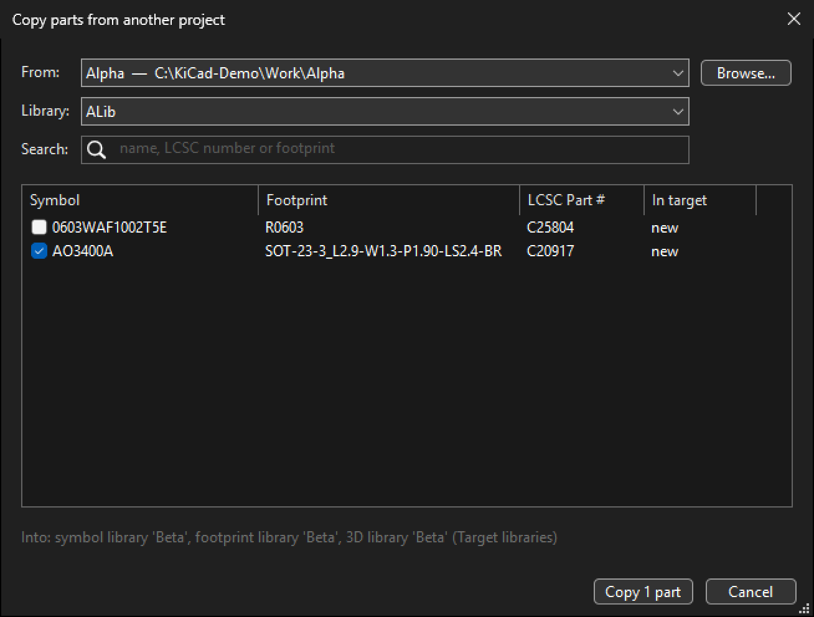</p>

Tick the parts (search by name, LCSC number or footprint). For each one PartHive
copies the **symbol** (and its parent, for derived symbols), the **footprint** its
`Footprint` field points at, and that footprint's **3D model** — into the
**Target libraries** — and re-points the links: `ALib:SOT-23-3…` → `Beta:SOT-23-3…`,
and the 3D path → `${KIPRJMOD}/Libraries/Beta.3dshapes/…`. Parts that already exist
are skipped. The source library is only read.

It works in both directions: on the **Project** card you copy *into* the project
(also from a global library); on the **Global** card you copy *into* a global
library — handy to promote a part that turned out to be common.

## Fix links after pasting a circuit

Copy a circuit from one project's schematic into another and its symbols still
point at the old project's library — ERC then reports *library not found*. When
PartHive opens, it scans the project's schematic and says so:

<p align="center">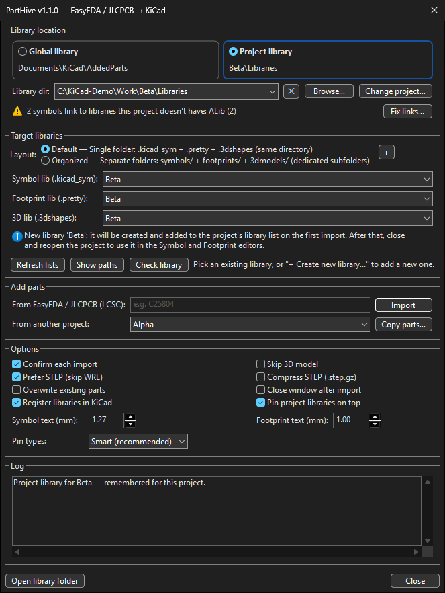</p>

**Fix links…** shows each missing library, the symbols that use it, where it was
found, and how to fix it:

<p align="center">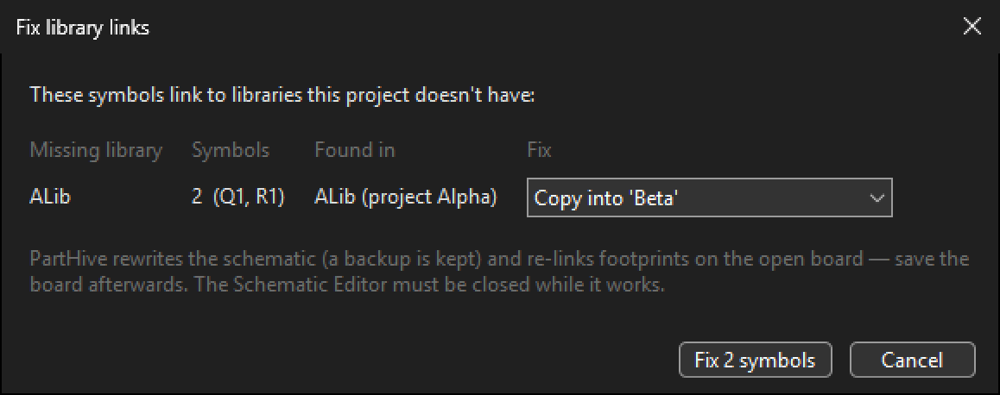</p>

| Fix | What happens |
|---|---|
| **Copy into the Target library** | the library still exists in another project (or globally): the used parts are copied over, as above |
| **Re-link (same LCSC Part #)** | this project already has the very same parts: the symbols are pointed at them |
| **Recover from schematic** | the library is gone everywhere: the symbol is rebuilt from the copy every schematic keeps of it |
| **Leave as is** | nothing changes |

PartHive then rewrites the schematic's library links (`ALib:AO3400A` →
`Beta:AO3400A`), the symbols' Footprint fields and the schematic's own symbol
copies (so ERC sees they match the library), keeping a `.parthive-bak` backup;
footprints already on the open board are re-linked live — just save the board.
The **Schematic Editor must be closed** while it works (KiCad would overwrite the
file when saving the open schematic); PartHive tells you if it's still open.

Tested against KiCad's own ERC (`kicad-cli sch erc`): a pasted circuit with three
broken symbols goes from 3 symbol + 3 footprint library warnings to none.

The notice is about the project's schematic, so it appears whichever card is
selected; fixed parts go to the selected Target libraries (a project library on
the Project card, a global one on the Global card).

## Live notices

The line under the library rows always tells you what's next:

ℹ️ **New library** — created and added to KiCad on the first import:

<p align="center">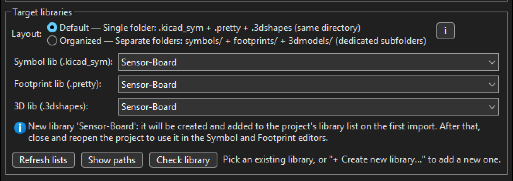</p>

⚠️ **Restart needed** — inside the PCB editor PartHive asks KiCad what it has
loaded, so this stays until the restart really happened:

<p align="center">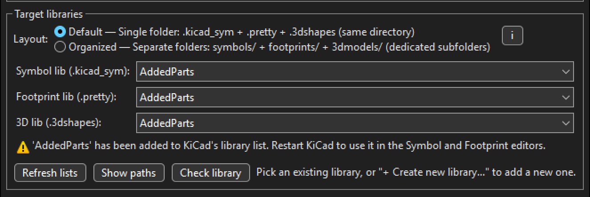</p>

⛔ **Name clash** — the name already belongs to another library (here: the project's):

<p align="center">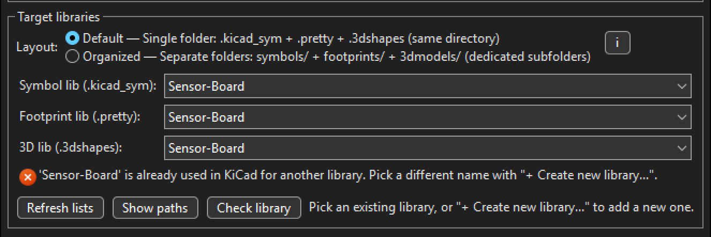</p>

## Options

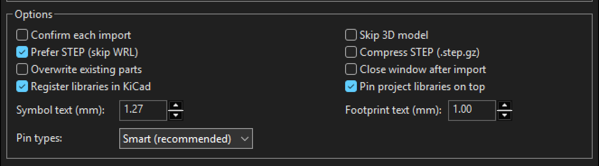

Hover any option for the details.

- **Pin project libraries on top** *(on by default)* — pins project libraries at
  the top of *Add Symbol* / *Add Footprint*. KiCad rewrites the open project's file
  when it saves or closes, so a small hidden helper waits until you close the
  project, then writes the pin. Each library is pinned once; if you unpin it, it
  stays unpinned.
- **Confirm each import** shows the per-item dialog (with similar footprints);
  **Overwrite existing parts** applies when it's off.
- **Prefer STEP**, **Compress STEP (.step.gz)**, **Skip 3D model**, **Close window
  after import** and the text sizes behave as labelled.
- **Pin types** — see below.

## Pin types

EasyEDA's part data is weak on electrical pin types: most parts arrive with every
pin *undefined* (KiCad: *unspecified*, so ERC warns everywhere), and some are
simply wrong — real examples:

| Part | EasyEDA says | PartHive *Smart* makes it |
|---|---|---|
| 10k resistor (C25804) | both pins **input** | passive |
| AO3400A MOSFET (C20917) | all undefined | passive |
| AMS1117-3.3 (C6186) | all undefined | GND, VIN power in · VOUT **power out** · 2nd VOUT (tab) passive |
| RP2040 (C2040) | GND, DVDD, IOVDD… **bidirectional** | supplies power in · VREG_VOUT power out · GPIO bidirectional |

**Smart** *(default)* follows KiCad's own libraries:

1. **Discrete parts** (reference R, C, L, D, Q, Y, F, FB, J, SW, …): every pin **passive**.
2. **IC pins by name**, overriding EasyEDA when it's undefined or contradicts the name:
   `GND`, `VSS`, `VCC`, `VDD*`, `AVDD`, `IOVDD`, `VIN`, `VBAT`, `VBUS`, `USB_VDD`,
   `VREG_IN`… → **power in** · `VOUT`, `VO`, `VREG_VOUT`, `LDO_OUT` → **power out**
   (only the first pin of a name — repeats such as the AMS1117's VOUT tab become
   passive, or ERC would see two power outputs on one net) · `NC`, `DNC` → **no
   connect** · `EP`/`EPAD` → passive.
3. **Other IC pins** keep EasyEDA's type when it set one, otherwise **bidirectional**.

The other choices are **Keep EasyEDA's** and **All passive**.

> **PWR_FLAG.** With real power pins, ERC can check your supplies — and a net fed
> only through a connector (XT60, terminal block) or a resistor (inrush limiter)
> is reported as *power input not driven*, because connector and resistor pins
> are passive. That's KiCad's intended design: place a **PWR_FLAG** on such nets
> (the input rail, the rail after the resistor, GND) to acknowledge "this net is
> powered from outside". Don't make connector pins power out/in — two inputs on
> one rail, or a pass-through in/out connector, would then clash.

## Symbol fields

Every imported symbol carries (hidden) ordering fields:

| Field | Example |
|---|---|
| `LCSC Part #` | `C25804` |
| `JLCPCB Link` | `https://jlcpcb.com/partdetail/26547-0603WAF1002T5E/C25804` |

## Name rules

A library name becomes a file name, a KiCad library name and part of a path, so
PartHive refuses names that would break any of them:

| Not allowed | Why |
|---|---|
| `< > : " / \ \| ? *` | illegal in Windows file names; `:` splits `Lib:Item` |
| `$` `%` | read as variables by KiCad / Windows |
| `CON` `PRN` `AUX` `NUL` `COM1–9` `LPT1–9` | reserved device names on Windows |
| leading/trailing space or dot, control characters | dropped or hidden by the OS |
| more than 64 characters | Windows paths stop at 260 characters |
| a name KiCad already uses (any case) | KiCad knows libraries only by name — including its built-in ones like `power` |

## Where PartHive keeps things

| What | Where |
|---|---|
| Settings | `%APPDATA%\PartHive\settings.json` |
| Per-project choice and pins | `%APPDATA%\PartHive\projects\` |
| Backups of edited KiCad files | next to them, as `*.parthive-bak` |

PartHive writes KiCad files atomically and keeps their line endings.

## Building the install zip

Releases are built by GitHub Actions: pushing a tag `v<version>` builds
`PartHive-<version>.zip`, publishes it on the Releases page with its
`metadata.json` (download link, SHA-256 and sizes) and updates the
NeoCircuitsLab PCM repository. Every push to `main` builds a test zip too
(*Actions* tab → the run → *Artifacts*).

To build it yourself (any Python 3.8+; `pip install pillow` scales the icon):

```bash
git clone --recurse-submodules https://github.com/neocircuitslab/PartHive.git
cd PartHive
python tools/build_zip.py
```

This writes `dist/PartHive-<version>.zip`. The version in
`plugins/parthive_paths.py` must match `metadata.json`.

## License and credits

PartHive's own code is **GPL-3.0-or-later** ([LICENSE](LICENSE)). It bundles the
AGPL-3.0 converter `easyeda2kicad_ph` — a git submodule in
`plugins/easyeda2kicad-ph/`, kept in its own repository
[neocircuitslab/easyeda2kicad-ph](https://github.com/neocircuitslab/easyeda2kicad-ph)
because of its different license. It is NeoCircuitsLab's fork of
[easyeda2kicad.py](https://github.com/uPesy/easyeda2kicad.py) by uPesy — see
[NOTICE.md](NOTICE.md).

"KiCad", "EasyEDA", "JLCPCB" and "LCSC" are trademarks of their respective owners;
PartHive is not affiliated with them.
